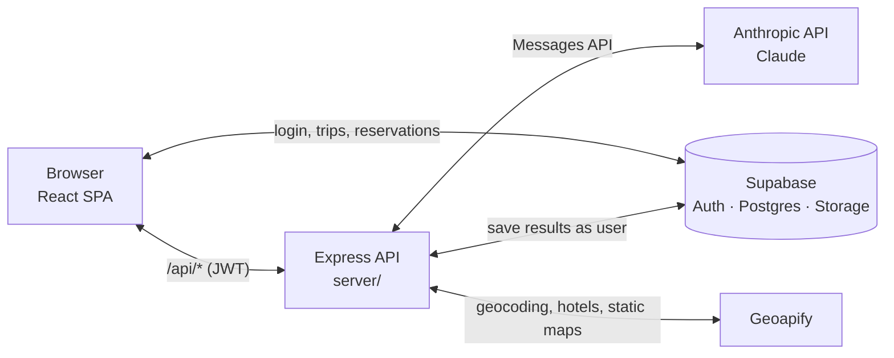

# Trip Planner

An AI-powered travel planning web app. A signed-in user describes a trip, and the app uses Claude to generate a day-by-day itinerary, with a map of each day's stops, local events, the best places to eat nearby, and all their flight and hotel confirmation codes in one place. Any trip can be downloaded as a PDF for use offline.

📄 A printable version of this overview is in [docs/Trip-Planner-Overview.pdf](docs/Trip-Planner-Overview.pdf).

## What it does

- **Plan a trip**: a five-step questionnaire collects the destination (type-to-search over 213 countries and territories, including Puerto Rico and the U.S. Virgin Islands, with nicknames like "USA" or "Bali") and one or more cities with check-in/check-out dates, up to 14 days in total; flight details (optional); where the traveler is staying (a hotel found through hotel search, a custom address, or none) with an optional hotel confirmation code; and their travel style and vacation type. Addresses are validated as they're entered.
- **Background generation**: the trip is saved immediately as *pending*, and the server generates the itinerary with Claude. Flight times are used to keep arrival days light and leave time for the airport. The user sees an animated progress screen and can leave; the finished itinerary appears on their dashboard when it's ready. If the server restarts mid-generation, it picks the job back up.
- **Dashboard**: a "Welcome back" page built around the next trip:
  - **Next-trip card** with a destination photo, a countdown ring ("22 days to go", or "Day 3 of 9" during the trip) and a **Before you go** checklist taken from the trip itself: itinerary ready, flights added, hotel confirmation saved, offline PDF downloaded. Each item links to the right place.
  - **Upcoming trips** as a list with live badges (*In 22 days*, *Happening now*, *Generating…*, *Draft*, *Failed*), and **Past trips** as a separate photo grid. Trips shared with you are tagged *Shared*.
  - A sidebar with a **mini calendar** of the next trip's month, **travel stats** (trips, countries, days away) and **ideas** that start a new trip with the destination filled in.
  - New users see a "Where will your first trip take you?" welcome with popular destinations instead.
  - On phones, a bottom tab bar (Trips · Calendar · New · Profile).
- **Trips calendar** (`/calendar?month=YYYY-MM`): in the dashboard's style, a month grid with every trip as a colored bar (past trips faded, drafts dashed), a month strip for jumping around the year (dots mark months with trips), Today / Previous trip / Next trip, and a side column with the month's trips (hover to highlight on the grid), what's coming up and the year at a glance. Covers the month the account was created to a year ahead.
- **Travel Crew**: invite travel partners with a shareable link (copy, share sheet or email). Friends with an account join and see the trip on their dashboard; anyone else can join that one trip as a guest with just a name and email. Avatar bubbles show who's going. Partners and guests can view the trip but not change it, and can keep their own flights and hotels in **My reservations**. Everyone only ever sees their own confirmation codes: partners get shared trips from the server with the organizer's reservations and codes removed, so those never reach a partner's browser.
  - By default the organizer **approves each new traveler** (a setting in the invite window); until then the trip stays hidden from them.
  - Up to **10 travelers** besides the organizer. Invite links expire after 30 days or when the trip ends, whichever is first, and guest links stop working 30 days after the trip.
- **Notifications**: a bell in the header with an unread count and the latest five notifications ("Sam would like to join your trip to Ireland", with Approve / Deny right there, plus itinerary ready or failed and approvals), and a full list at `/notifications`. Checked every minute.
- **Itinerary view**: a per-day interactive map (stops and hotel), the day's stops in order, and tips and hotel details, with an **Invite travel partner** button and who's-going bubbles. A side menu opens four more sections:
  - **Local Events** happening during the trip, with details for each one.
  - **Food Spots**: the top 12 places to eat in each city, generated alongside the itinerary, with "Load 10 more". Each spot shows its cuisine, price, neighborhood and distance from the traveler's hotel, and is pinned on a map next to the hotel. A toggle sorts the list by "Closest to homebase".
  - **Reservations** (organizer): every flight and hotel with its confirmation code (tap to copy). Hotels from the questionnaire appear automatically; flights and other hotels can be added, edited or deleted.
  - **My reservations** (partners and guests): the same screen for the flights and hotels *they* booked. Only that person can see them: not the organizer and not other travelers. They're included in the partner's own PDF.
  - **Travel Crew**: everyone on the trip with their photo, role and bio; the organizer can invite and remove people, approve or deny join requests, save people to their saved travelers, and see a member's emergency contact around the trip dates if that member shares it. Partners can leave.
- **Offline PDF**: "Download PDF" (on the itinerary page and in each trip's ⋮ menu) builds a PDF with the reservations and codes, a map and stop list for every day, 10 local events, and 10 food spots per city.
- **Accounts**: sign up or sign in with email and password or with Google, and password reset.
- **My Profile** (`/profile`): photo, completeness meter, and four sections (`?tab=` opens one):
  - **About me**: name, phone, birthday, gender, bio (shown to travel partners) and home country ("Based in").
  - **Safety & accessibility**: accessibility and dietary needs, which new itineraries and food spots plan around, and an emergency contact the organizer of a trip can see from 2 days before it until it ends (only if the user turns sharing on).
  - **Travel documents**: passport, Known Traveler Number, insurance, visas and more, with hidden numbers and expiry warnings (passports 6 months out). Private to the user.
  - **Saved travelers**: people the user travels with; "Invite to a trip" picks one of their upcoming trips and emails or copies its invite link.
- **Installable**: a Progressive Web App with offline caching of the app shell and map tiles.

## Technology

### Frontend

A single-page app in [`src/`](src/).

| Technology | Used for |
|---|---|
| React 18 | UI, function components and hooks |
| Vite 5 | Dev server and production build; compiles Tailwind through PostCSS |
| React Router 6 | Routes: `/`, `/new`, `/drafts/:id`, `/trip/:id`, `/calendar`, `/profile`, plus `/join/:token` and `/guest/:token`, which work without signing in |
| TanStack Query 5 | Fetching, caching and saving trips; refreshes the organizer's pending trip when Supabase Realtime reports a change (polling every 15 s as a fallback), and polls a shared pending trip every 5 s |
| Tailwind CSS 3 | Styling; one shared theme in [`src/utils/theme.js`](src/utils/theme.js) |
| Framer Motion | Animations: page transitions, modals, the loading screen's globe and plane |
| Leaflet + react-leaflet | Interactive maps on OpenStreetMap tiles |
| lucide-react | Icons |
| vite-plugin-pwa | Service worker and web-app manifest |

### Backend and services

| Technology | Used for |
|---|---|
| Node.js + Express 5 | Server in [`server/`](server/): the API (itinerary generation, food spots, PDF export, hotel search, address validation) and, in production, the built frontend, all on one port. Holds the secret API keys. |
| Anthropic SDK | Calls Claude (`claude-sonnet-5`): streams the itinerary as JSON, and picks food spots (at low effort, for speed) |
| Supabase | Authentication (email/password and Google), Postgres database (`trips`, `members`, `trip_members`, `trip_invites`, `notifications`) and file storage (avatars). Used directly by the browser, and by the server acting as the signed-in user or, for Travel Crew, with the service role key. |
| Geoapify | Hotel search, address validation, map coordinates for food spots and homebases, and static map images for the PDF |
| pdfkit | Builds the offline PDF on the server |
| Docker + Railway | Multi-stage image that runs one Node server. Deployed on Railway, which rebuilds on every push; GitHub Actions also builds the image in CI. |

### Server modules

| File | What it does |
|---|---|
| [`server/index.js`](server/index.js) | Express routes (reading and writing trips as the signed-in user), the 14-day trip limit, and serving the built frontend in production |
| [`server/itinerary.js`](server/itinerary.js) | Builds the itinerary prompt, calls Claude, parses the JSON |
| [`server/foodSpots.js`](server/foodSpots.js) | Asks Claude for a city's best places to eat, then locates them on the map |
| [`server/geoapify.js`](server/geoapify.js) | Geocoding, homebase lookup and static maps, rate-limited to the free tier (≤ 4 requests/s) |
| [`server/pdf.js`](server/pdf.js) | Lays out the offline PDF |
| [`server/generationJobs.js`](server/generationJobs.js) | Runs itinerary generation as a job that survives restarts: heartbeat, 10-minute timeout, and a sweeper that retries or fails jobs a stopped server left behind |
| [`shared/tripLength.js`](shared/tripLength.js) | Trip length and the 14-day limit, used by both the questionnaire and the server so they always agree (tests: `npm test`, run by Vitest) |
| [`shared/accessibility.js`](shared/accessibility.js) | The accessibility and dietary options on the profile page, and how they're described to Claude |
| [`server/travelerProfile.js`](server/travelerProfile.js) | Reads the organizer's accessibility and dietary needs for the itinerary and food spot prompts |
| [`server/tripData.js`](server/tripData.js) | Merging changes into a trip's `itinerary_data` without overwriting edits made meanwhile |
| [`server/limits.js`](server/limits.js) | Who's calling (from the Supabase token), rate limits per account or IP, and the daily cap of 4 itinerary generations per account |
| [`server/memberReservations.js`](server/memberReservations.js) | Partners' and guests' own reservations: add, edit, delete and list, always filtered to the person asking. Table: `member_reservations` (server-only, no browser access) |
| [`server/crew.js`](server/crew.js) | Travel Crew: invite links (expiry, approval setting), joining or asking to join as a member or guest, approving and denying requests, the 10-traveler limit, the crew list, the guest's view-only trip, a partner's shared view of a trip (`GET /api/trips/:id/shared`, without the organizer's reservations), and removing people |
| [`server/notifications.js`](server/notifications.js) | Creates in-app notifications (join requests, approvals, itinerary ready or failed); the browser reads them directly |

## Architecture

The browser talks to Supabase directly for sign-in and for reading or writing trips. Anything that needs a secret key goes through the Express server.



### How an itinerary is generated

1. The user finishes the questionnaire. The browser saves the trip to Supabase with status *pending* and its form answers.
2. The browser calls `POST /api/generate-itinerary` with only the trip id and the user's login token, then opens `/trip/:id`, which shows the progress screen.
3. The server checks the user owns the trip, records a **generation job** (`generation_jobs`), replies right away, and continues in the background. In parallel, with a 10-minute time limit, it:
   - streams the itinerary from Claude (the prompt includes flight routes and times, but never confirmation codes),
   - asks Claude for 12 food spots per city and finds each one on the map with Geoapify,
   - looks up each city's hotel or homebase location.
4. The server merges everything into the trip with status *ready* (or *failed* with the error), re-reading the row first so edits made in the meantime aren't overwritten, and notifies the user.
5. The progress screen and the dashboard hear about the change through Supabase Realtime (or a 15-second poll as a fallback) and switch to the itinerary as soon as it's ready, even if the user left and came back. Travel partners don't get Realtime for the organizer's trip; their app re-fetches the shared view every 5 seconds while it's generating.

If the server restarts or redeploys mid-generation, the job's heartbeat (refreshed every 30 seconds) goes stale. A sweeper, run on startup and every minute, retries the job once and then marks the trip *failed* in the database, giving back the daily generation slot. Trips left *pending* whose generation never started are marked failed after 15 minutes.

### What's stored on a trip

Everything lives in the trip row's `itinerary_data` JSON, so no database schema changes were needed:

| Key | Contents |
|---|---|
| `days`, `spots`, `events` | The itinerary from Claude |
| `_form_data` | The questionnaire answers, including `reservations` (flights and hand-added hotels) and each hotel's confirmation code |
| `_status`, `_error` | `pending` / `ready` / `failed` (drafts are marked with `_draft`) |
| `_food_spots` | Food spots per city, with coordinates |
| `_homebases` | Each city's hotel or homebase location, for distances and the map |
| `_pdf_downloaded_at` | When the offline PDF was last downloaded, for the dashboard checklist |

Travel Crew is the exception: who's on a trip lives in its own tables, `trip_members` and `trip_invites`, created by [`supabase/travel-crew.sql`](supabase/travel-crew.sql), Members can't read `trips` directly: only the owner can (row-level security). The app reads a shared trip through the server's `GET /api/trips/:id/shared`, which checks the person is an approved member and removes the organizer's reservations, confirmation codes and notes, and finds which trips to load from the member's own `trip_members` rows ([#62](https://github.com/rizekj12/Trip-Planner/issues/62); [`supabase/fix-shared-trip-access.sql`](supabase/fix-shared-trip-access.sql) removes the old direct-read policy). [`supabase/invite-approvals-notifications.sql`](supabase/invite-approvals-notifications.sql) adds join requests (`trip_members.status`: pending or approved; only approved members can view the trip), invite link expiry and the approval setting, and the `notifications` table (each user reads and marks read only their own). A user's name, photo and home country are stored on their login (`user_metadata`). Everything else on the profile page lives in [`supabase/profiles.sql`](supabase/profiles.sql)'s tables, each readable and writable only by its owner: `profiles` (phone, birthday, gender, bio, accessibility needs, emergency contact), `travel_documents` and `saved_travelers`. The server reads bios, shared emergency contacts and accessibility needs with the service role key. Travel partners' own reservations live in `member_reservations` ([`supabase/member-reservations.sql`](supabase/member-reservations.sql)), one row per flight or hotel, tied to the person's `trip_members` row (so leaving a trip deletes them). The browser can't query it at all; the server returns each person only their own rows.

A mock mode (`VITE_USE_MOCK_DATA=true`) skips the API and returns sample data for UI work.

## Component tree

How the React components nest at runtime, starting from [`src/main.jsx`](src/main.jsx). Notes on the right give the route or the condition under which a branch renders. `(local)` marks a component defined inside its parent's file.

```
main.jsx
└── QueryClientProvider                server-data cache (TanStack Query)
    └── AuthProvider                   one Supabase auth subscription; useAuth()
        └── BrowserRouter
            └── App                    <Routes>
                ├── JoinPage                               /join/:token (no sign-in needed)
                │   └── AuthScreen                         when choosing to sign in first
                ├── GuestTripPage                          /guest/:token (no sign-in needed)
                │   └── TripView                           view-only, with the crew list
                └── AuthGate                               everything else: login until signed in
                    ├── AuthScreen                         signed out: sign in / create account / Google
                    ├── ResetPassword                      password-recovery link
                    ├── DashboardPage                      /
                    │   ├── AppHeader                      logo · HomeCountryMenu · Calendar · NotificationBell · ProfileMenu
                    │   │   └── NotificationBell           unread count, latest 5, Approve / Deny
                    │   │       └── NotificationItem
                    │   ├── NextTripCard                   photo, countdown ring, Before you go
                    │   │   ├── TripThumb                  destination photo or flag tile
                    │   │   └── CrewBubbles                invite button + who's going
                    │   ├── TripCardMenu (local)           Download PDF / Retry / Delete / Leave
                    │   ├── MiniCalendar, TravelStats, TripIdeas   sidebar
                    │   ├── FirstTripHero                  no trips yet
                    │   └── BottomTabBar                   phones
                    ├── NewTripPage                        /new, /drafts/:draftId
                    │   ├── LoadingScreen                  while a draft loads
                    │   └── TripQuestionnaire              5-step form
                    │       ├── WhereWhenStep              destination, cities, dates (≤ 14 days)
                    │       │   ├── DestinationPicker      type-to-search destinations
                    │       │   └── CityAutocomplete (local)
                    │       ├── FlightsStep                optional flights
                    │       │   └── FlightFields
                    │       ├── AccommodationStep          hotel / address / skip, hotel code
                    │       │   ├── HotelSearchModal       Geoapify search
                    │       │   └── Modal                  skip-homebase confirm
                    │       ├── StyleStep                  travel style, vacation type
                    │       └── ReviewStep
                    ├── TripPage                           /trip/:tripId (picks a view by status)
                    │   ├── GeneratingScreen               pending: globe + plane
                    │   ├── FailedScreen (local)           failed: error + Try again
                    │   └── TripView                       ready (owner or travel partner)
                    │       ├── SkyBackground, ProfileMenu
                    │       ├── CrewBubbles                invite button + who's going
                    │       │   ├── InviteModal            link, email, share, reset
                    │       │   └── Modal                  who's going list
                    │       ├── SideNav                    days, Local Events, Food Spots, Reservations, Travel Crew
                    │       ├── DayMap                     Leaflet map of the day
                    │       │   ├── MarkerInfoModal        uses Modal
                    │       │   └── HotelInfoModal         uses Modal
                    │       ├── ItineraryCard
                    │       │   └── TodayStopsList
                    │       ├── EventsPanel                Local Events section
                    │       │   ├── EventImage             photo or category icon
                    │       │   └── EventModal             uses Modal + EventImage
                    │       ├── FoodSpotsPanel             Food Spots section
                    │       │   └── DayMap                 spots + hotel pins, no popups
                    │       ├── ReservationsPanel          Reservations section (owner only)
                    │       │   └── Modal                  add / edit form: FlightFields, HotelFields
                    │       └── CrewPanel                  Travel Crew section
                    ├── CalendarPage                       /calendar?month=YYYY-MM
                    │   ├── AppHeader
                    │   ├── TripThumb                      side list of the month's trips
                    │   └── BottomTabBar                   phones
                    ├── NotificationsPage                  /notifications
                    │   ├── AppHeader
                    │   ├── NotificationItem               one per notification
                    │   └── BottomTabBar                   phones
                    └── ProfilePage                        /profile (?tab=about|safety|documents|travelers)
                        ├── AppHeader, BottomTabBar
                        ├── AboutSection                   name, phone, birthday, gender, bio
                        │   └── HomeCountryMenu            "Based in" (light style)
                        ├── SafetySection                  accessibility needs, emergency contact
                        ├── DocumentsSection               document list + add/edit Modal
                        └── TravelersSection               saved travelers, add/edit Modal, Invite to a trip
```

## Running locally

Requires Node.js 20.6+ (the server script uses `--env-file`). Create a `.env` file in the project root:

```bash
VITE_SUPABASE_URL=...
VITE_SUPABASE_ANON_KEY=...
ANTHROPIC_API_KEY=...
GEOAPIFY_API_KEY=...
# Server only (Supabase → Project Settings → API → service_role). Never prefix with VITE_.
SUPABASE_SERVICE_ROLE_KEY=...
# Optional: origins allowed to call the API from a browser (default: localhost:3000)
# CORS_ORIGINS=http://localhost:3000
# Optional: log level (trace, debug, info, warn, error, silent). Default: debug locally, info in production
# LOG_LEVEL=info
# Optional: use sample data instead of calling Claude
# VITE_USE_MOCK_DATA=true
```

Run [`supabase/travel-crew.sql`](supabase/travel-crew.sql), then [`supabase/generation-limits.sql`](supabase/generation-limits.sql), [`supabase/invite-approvals-notifications.sql`](supabase/invite-approvals-notifications.sql) [`supabase/generation-jobs.sql`](supabase/generation-jobs.sql), [`supabase/profiles.sql`](supabase/profiles.sql), [`supabase/member-reservations.sql`](supabase/member-reservations.sql) and [`supabase/fix-shared-trip-access.sql`](supabase/fix-shared-trip-access.sql), once in Supabase's SQL Editor (they create the Travel Crew tables and sharing rules, the log behind the daily itinerary cap, join requests and notifications, generation jobs plus Realtime for trips, the profile page's tables, travel partners' own reservations, and removing partners' direct access to trip rows). Then:

```bash
npm install
npm run dev:all   # Express API on :3001 (auto-restarts on save) + Vite on :3000
npm run lint      # ESLint (errors fail CI; warnings don't)
npm test          # unit and component tests (Vitest); npm run test:watch re-runs on save
```

## Deploying (Railway)

In production one Node server serves both the API and the built app; it listens on Railway's `PORT`.

1. **New Project → Deploy from GitHub repo**; Railway builds the [`Dockerfile`](Dockerfile).
2. **Variables**: `VITE_SUPABASE_URL`, `VITE_SUPABASE_ANON_KEY`, `ANTHROPIC_API_KEY`, `GEOAPIFY_API_KEY`, `SUPABASE_SERVICE_ROLE_KEY` (the `VITE_` ones are also used at build time). Don't set `PORT`.
3. **Settings**: Networking → Generate Domain; Deploy → Healthcheck Path `/health`.
4. Add the Railway URL to Supabase (**Site URL** and **Redirect URLs**, e.g. `https://<app>.up.railway.app/**`) and to Google Cloud (**Authorized JavaScript origins**).

## Roadmap

### Next features

- **Gallery tab**: a shared photo and video gallery for each trip that the organizer, travel partners and guests can all add to
- **Live location on the day-by-day maps**: let the site use the device's location to show where you are
- **Invite emails (Travel Crew phase 2)**: send invites and trip notifications for guests by email from the app, and verify a guest's email with a magic link before they join (needs an email service such as Resend)
- **More notifications**: "your trip is coming up" reminders, and live updates instead of checking every minute

### Later

- Edit a generated trip
- Destination photos for every country (Unsplash API; today 9 destinations have photos, the rest show their flag)
